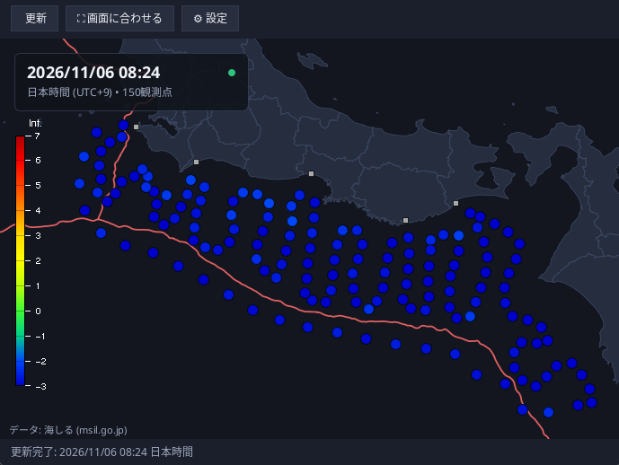

# SnetViewer

Java desktop application for visualizing [S-net](https://www.seafloor.bosai.go.jp/S-net/) data from [MSIL](https://www.msil.go.jp/).



Get the app in [Releases](https://github.com/Kiriyashiki/SnetViewer/releases).

## About

Data is updated every minute. Please note the data is usually 90-120s behind realtime.

- **Keyboard Shortcuts**:

| Action | Shortcut / Input |
|---|---|
| **Pan** | Left Click or Middle Click + Drag |
| **Zoom In / Out** | Mouse Wheel / `+` / `-` |
| **Reset View (Fit)** | Double Click / `Space` / `R` / Button |
| **Toggle Station IDs** | `L` / Checkbox |
| **Manual Refresh** | `F5` / Refresh Button |
| **Inspect Station** | Hover cursor over circle marker |

- **Settings**:
  - Language: English and Japanese
  - Map Rotation
- **Cross-Platform**: Compatible with Linux, Windows, and macOS.

Requires Java 17 or newer installed.

## Build

### Using `build.sh` (Standalone, zero dependencies)
```bash
./build.sh
```

### Using Maven
```bash
mvn clean package
java -jar target/snet-viewer-1.0.0.jar
```

### Using Gradle
```bash
gradle build
gradle run
```

### Creating a Production Release

```bash
./release.sh            # uses the version from pom.xml
./release.sh 1.2.3      # build a specific version
```

This creates `dist/SnetViewer-<version>.zip`, containing the runnable JAR and
launcher scripts for Linux (`run-linux.sh`), macOS (`run-macos.command`), and
Windows (`run-windows.bat`).

Releases are published automatically as drafts by the GitHub Actions workflow
when a `v*` tag is pushed, or manually through the **Release** workflow with a
version input.

## Data sources

- [MSIL](https://www.msil.go.jp/): S-net monitoring data
- [NIED](https://www.seafloor.bosai.go.jp/st_info/): S-net station data
- [JMA GIS](https://www.data.jma.go.jp/developer/gis.html): Japan basemap & trenches
- [ingen084/KyoshinShindoColorMap](https://github.com/ingen084/KyoshinShindoColorMap): Intensity color mappings
